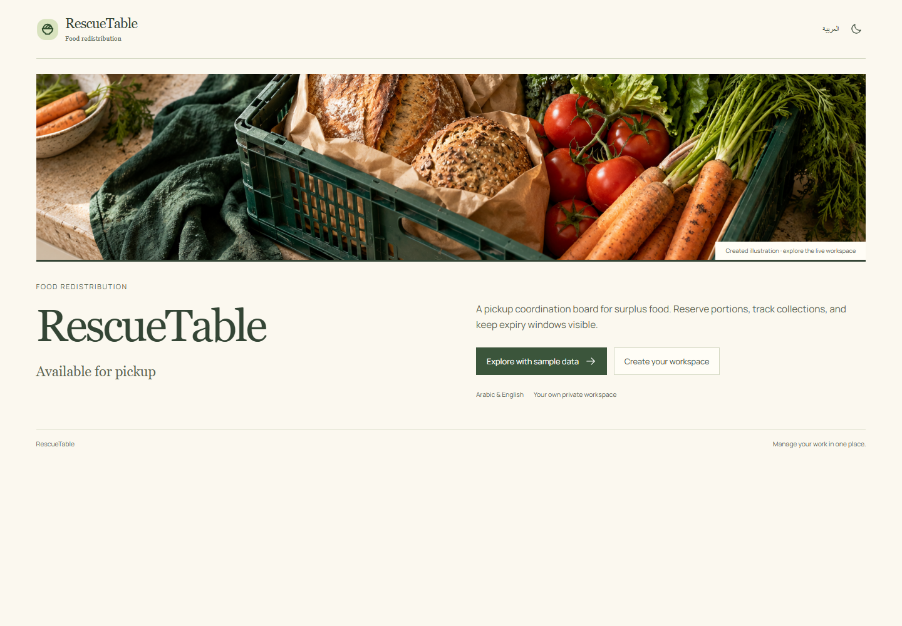
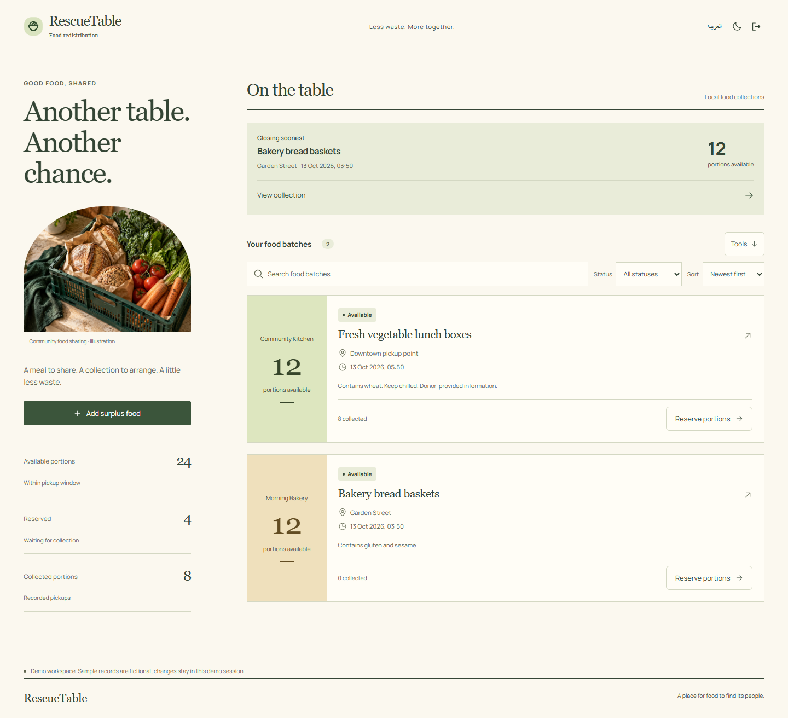
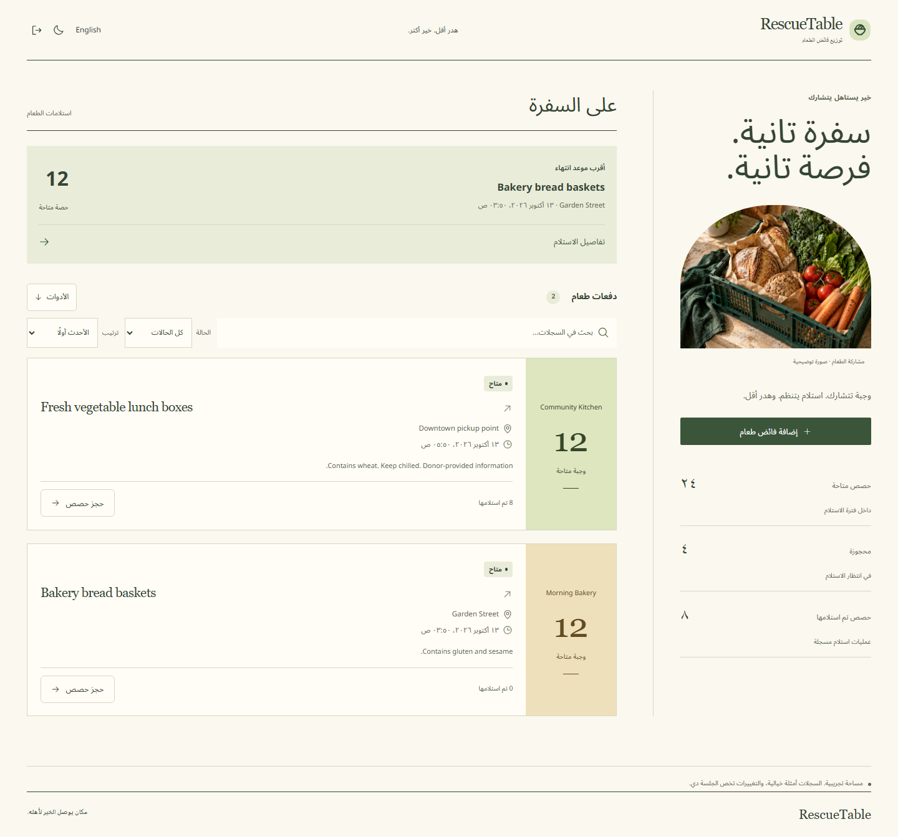
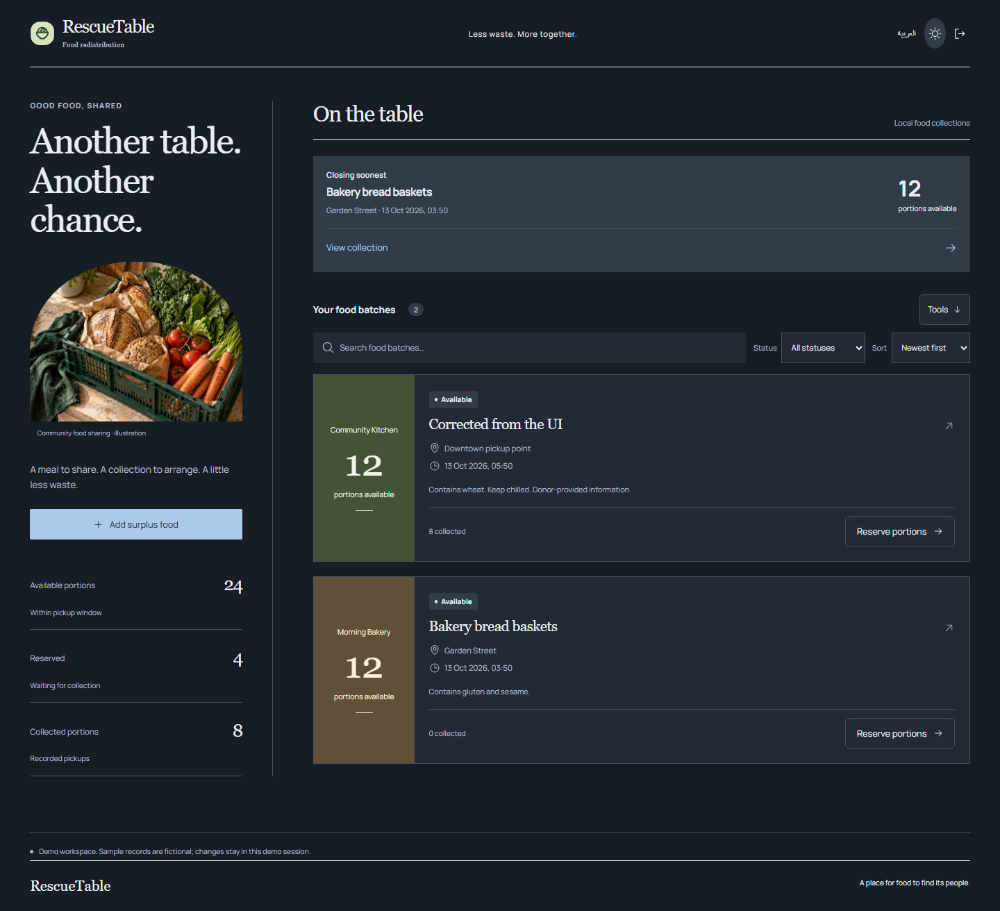

# RescueTable

### Good food deserves another table.



For local coordinators recording surplus food offers and their collection.

[Run locally](#run-locally) · [العربية](#بالعربي) · [Report a bug](https://github.com/Ahmed-Khalil-Mohamed/rescuetable/issues/new?template=bug_report.yml) · [Suggest an improvement](https://github.com/Ahmed-Khalil-Mohamed/rescuetable/issues/new?template=feature_request.yml)

[](https://github.com/Ahmed-Khalil-Mohamed/rescuetable/actions/workflows/quality.yml) [](LICENSE) 

## A shorter path from surplus to collection

1. Add a batch, donor, pickup location, portions, deadline and donor-provided allergen notes.
2. Reserve portions for a named collector; try reserving more than available to see server validation.
3. Record collection or release a reservation. Expired batches cannot be newly reserved or collected.



## Run locally

Use **Node.js 24 or newer** and npm.

```sh
git clone https://github.com/Ahmed-Khalil-Mohamed/rescuetable.git
cd rescuetable
npm ci
npm run dev
```

Open **http://localhost:4313/rescuetable**. Create an account or explore a separate demo workspace. For a production build, run `npm run build` then `npm start`.

Each checkout owns its dependency lockfile, server, tests and SQLite storage. The browser process uses `data/rescuetable.sqlite` and the `rescuetable_session` cookie. [Deployment and backups](docs/DEPLOYMENT.md).

## Behind the workflow

- Available + reserved + collected always equals the original portion count.
- Version checks prevent stale clients from double-reserving the same capacity.
- Deadline validation runs on the server; hiding a UI button is not the security boundary.

## More of the interface

<details>
<summary>Arabic workspace / الواجهة العربية</summary>



</details>

<details>
<summary>Dark workspace</summary>



</details>

Warm paper, editorial serif headlines, an illustrated left column and food offers on the right. Portion labels and collection deadlines determine the hierarchy.

Screenshots show the actual interface with fictional demonstration records. [Design notes](DESIGN.md) · [Image and icon provenance](ASSETS.md).

## Checks you can run

```sh
npm run format:check
npm run check
npx playwright install chromium
npm run test:e2e
npm audit
```

Capacity preservation, expired reservations/collections, release, repeat collection rejection, and browser overbooking feedback. Local project results are in [VERIFICATION](docs/VERIFICATION.md).

The [Quality workflow](https://github.com/Ahmed-Khalil-Mohamed/rescuetable/actions/workflows/quality.yml) runs on Windows and Linux. The badge above reports the live result. Local evidence, test counts and known validation limits are documented in [VERIFICATION](docs/VERIFICATION.md).

## Current boundaries

A coordination tool, not a food-safety certification or a public donation marketplace. No cold-chain sensors, dietary recommendations, GPS routing, or donor verification.

The sample records are fictional. Interview intended users and measure task completion before claiming proven impact. A useful next study is to compare the complete workflow with the person’s current spreadsheet or paper process.

## بالعربي

لوحة تنسيق لفائض الطعام: حجز الكميات ومتابعة الاستلام وإظهار آخر موعد للاستلام.

بدّل اللغة من زر «العربية». البيانات التجريبية أمثلة وليست سجلات مستخدمين حقيقيين. [دليل التشغيل بالعربي](START-HERE-AR.md).

## Contribute and report

Use the [bug report](https://github.com/Ahmed-Khalil-Mohamed/rescuetable/issues/new?template=bug_report.yml) for a reproducible problem, or the [feature request](https://github.com/Ahmed-Khalil-Mohamed/rescuetable/issues/new?template=feature_request.yml) to explain a missing workflow. Reports in Arabic and English are welcome. Include the version, expected result and steps; use fictional records and redact personal data.

[Contribution guide](CONTRIBUTING.md) · [Private security reporting](SECURITY.md) · [Changelog](CHANGELOG.md) · [API](docs/API.md) · [Architecture](docs/ARCHITECTURE.md)

## License

[MIT](LICENSE). Third-party packages, fonts and icons retain their own licenses; see [THIRD-PARTY-NOTICES](THIRD-PARTY-NOTICES.md).
